# Архітектура персонального помічника

Документ описує, як влаштований код: пакети, ключові класи, залежності між шарами і
шлях однієї команди від введення до збереження. Як встановити й запустити програму,
описано в [README](../README.md).

## Зміст

1. [Загальна ідея](#1-загальна-ідея)
2. [Структура пакетів](#2-структура-пакетів)
3. [Залежності між шарами](#3-залежності-між-шарами)
4. [Домен](#4-домен)
5. [Застосунок: сервіси й порти](#5-застосунок-сервіси-й-порти)
6. [Інфраструктура: сховища](#6-інфраструктура-сховища)
7. [Презентація: CLI](#7-презентація-cli)
8. [Як усе збирається: main.py](#8-як-усе-збирається-mainpy)
9. [Шлях однієї команди](#9-шлях-однієї-команди)
10. [Обробка помилок](#10-обробка-помилок)
11. [Тести](#11-тести)
12. [Як розширювати](#12-як-розширювати)

## 1. Загальна ідея

Проєкт побудований як **шарова архітектура «порти й адаптери»** (hexagonal architecture):

- **Домен** містить сутності й правила, наприклад «телефон складається з 10 цифр» чи
  «ім'я контакту унікальне». Він нічого не знає ні про файли, ні про консоль.
- **Застосунок** містить сценарії використання (додати контакт, знайти нотатки за тегом)
  і **порти**: інтерфейси, через які сценарії звертаються до зовнішнього світу.
- **Інфраструктура** містить **адаптери**, тобто реалізації портів: JSON-файли, SQLite,
  пам'ять, системний годинник.
- **Презентація** — це консольний інтерфейс: питає користувача, викликає сервіси,
  показує результат.

Залежності спрямовані **лише всередину**, до домену. Тому сховище можна замінити, не
чіпаючи бізнес-логіки, а домен і сервіси тестуються без файлів і консолі.

## 2. Структура пакетів

```
src/personal_assistant/
├── main.py                      composition root: створює й з'єднує всі об'єкти
│
├── domain/                      ── ДОМЕН (без I/O) ──
│   ├── contact.py               Contact, ContactId: телефони, дні народження, пошук
│   ├── note.py                  Note, NewNote: текст, теги, час створення й зміни
│   ├── value_objects.py         Name, Phone, Email, Address, Tag, Birthday: валідація в конструкторі
│   ├── errors.py                ієрархія DomainError
│   └── sorting.py               ukrainian_sort_key: сортування за українською абеткою
│
├── application/                 ── ЗАСТОСУНОК ──
│   ├── ports.py                 ContactRepository, NoteRepository, Clock (typing.Protocol)
│   ├── contact_service.py       ContactService, ContactData, UpcomingBirthday
│   └── note_service.py          NoteService
│
├── infrastructure/              ── ІНФРАСТРУКТУРА ──
│   ├── factory.py               Settings, StorageBundle, STORAGE_BACKENDS, create_storage
│   ├── clock.py                 SystemClock: реальна дата й час
│   ├── paths.py                 resolve_data_dir: каталог даних
│   └── storage/
│       ├── memory/
│       │   └── repositories.py  InMemoryContactRepository, InMemoryNoteRepository
│       ├── json/
│       │   ├── file.py          JsonFile: атомарний запис, карантин пошкодженого файлу
│       │   ├── contact_repository.py   JsonContactRepository
│       │   └── note_repository.py      JsonNoteRepository
│       └── sqlite/
│           ├── database.py      SqliteDatabase: з'єднання, схема, storage_errors
│           ├── contact_repository.py   SqliteContactRepository
│           └── note_repository.py      SqliteNoteRepository
│
└── presentation/                ── ПРЕЗЕНТАЦІЯ (CLI) ──
    ├── cli.py                   AssistantCLI: цикл команд, перетворення помилок на повідомлення
    ├── registry.py              Command, CommandRegistry, CommandContext, Outcome
    ├── messages.py              усі тексти українською, ERROR_MESSAGES
    ├── commands/
    │   ├── __init__.py          build_registry()
    │   ├── contacts.py          add-contact, list-contacts, search-contacts, edit-contact, delete-contact, birthdays
    │   ├── notes.py             add-note, list-notes, search-notes, edit-note, delete-note, search-tag, notes-by-tag
    │   ├── system.py            help, exit / close
    │   └── _common.py           дрібні допоміжні функції для обробників
    └── io/
        ├── prompts.py           Prompter: покрокові запитання з повтором при помилці
        ├── parsers.py           розбір відповідей: телефони й теги через кому, числа, дати
        └── views.py             таблиці rich для контактів, нотаток, днів народження, help
```

## 3. Залежності між шарами

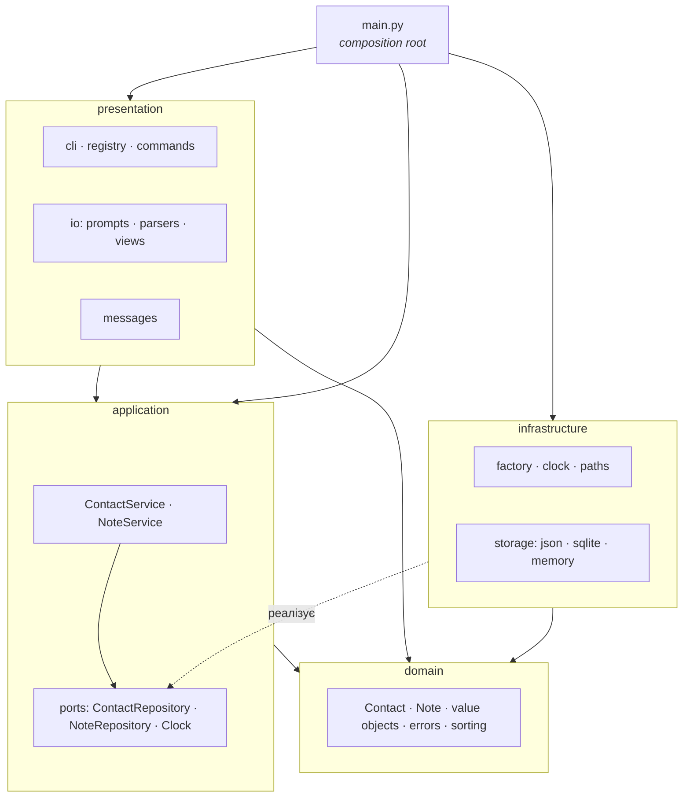

Правила:

| Шар | Може імпортувати | Не може імпортувати |
|---|---|---|
| `domain` | лише стандартну бібліотеку | будь-який інший шар, `rich`, `prompt_toolkit` |
| `application` | `domain` | `infrastructure`, `presentation` |
| `infrastructure` | `domain`, `application.ports` | `presentation`, сервіси |
| `presentation` | `domain`, `application` | `infrastructure` |
| `main.py` | усе | — |

Ключовий момент: **сервіси залежать від портів, а не від конкретних сховищ**. Хто саме
реалізує порт (JSON, SQLite чи пам'ять), вирішує лише `main.py` через `factory.py`.
Це інверсія залежностей (принцип **D** із SOLID).

## 4. Домен

### Сутності та value objects

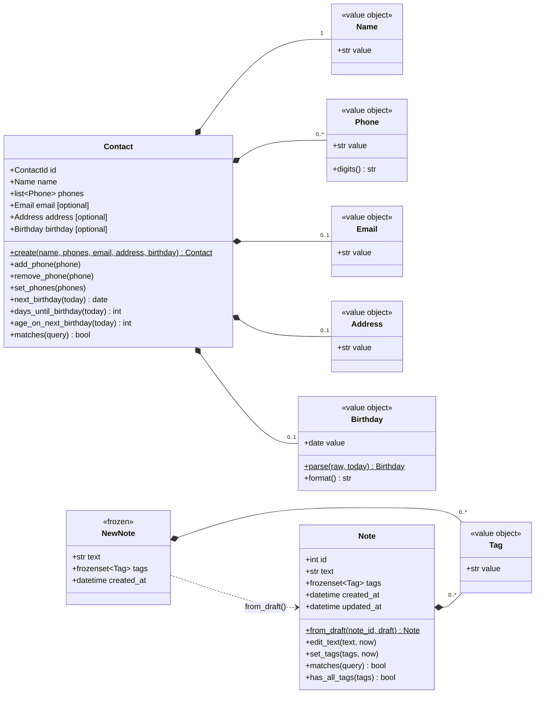

- **Value objects** (`value_objects.py`) — незмінні `frozen dataclass`. Значення
  перевіряється в `__post_init__`, і в разі помилки конструктор кидає відповідний
  `ValidationError`. Тобто **невалідний `Phone` неможливо створити**. Тому решта коду
  не перевіряє дані повторно, а `Prompter` просто передає конструктор як парсер.
- **`Contact`** — змінна сутність з ідентифікатором `ContactId` (UUID). Вона сама знає,
  коли наступний день народження, скільки років виповниться і чи підходить контакт під
  пошуковий запит.
- **`NewNote` і `Note`.** Нотатка отримує `id` лише після збереження: сховище видає
  номер, який ніколи не повторюється. Тому сервіс створює чернетку `NewNote`, а
  репозиторій повертає вже повну `Note`.
- **`sorting.ukrainian_sort_key`** сортує імена й теги за українською абеткою. Звичайний
  `sorted` ставить «і, ї, є, ґ» не на свої місця, а `locale` поводиться по-різному на
  різних ОС.

### Ієрархія помилок

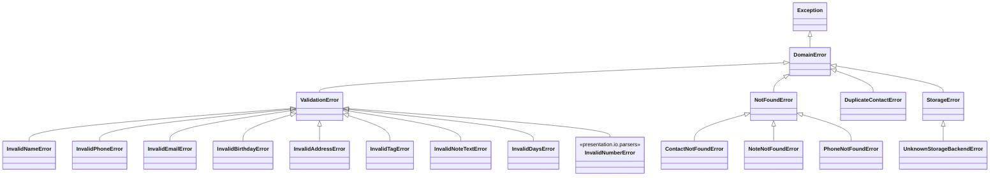

Помилки несуть **лише деталь** (наприклад, невалідне значення), а не текст для
користувача. Український текст до кожного класу визначено в
`presentation/messages.py::ERROR_MESSAGES`. Так домен не залежить від мови інтерфейсу.

## 5. Застосунок: сервіси й порти

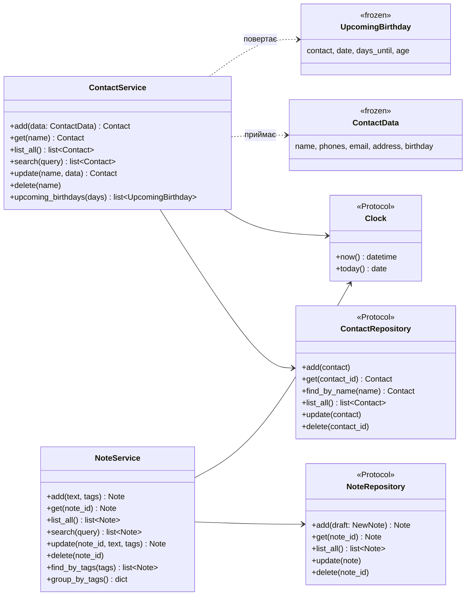

- **Порти** описані як `typing.Protocol` (структурна типізація). Адаптери не
  успадковують протокол: достатньо мати методи з потрібними сигнатурами, а mypy
  (`--strict`) перевіряє відповідність там, де адаптер передають у сервіс.
- Репозиторії працюють **на рівні окремих записів** (add/get/update/delete), а не
  «завантажити й зберегти весь файл». Завдяки цьому один інтерфейс однаково природно
  лягає і на JSON-файл, і на SQL-таблицю.
- **`Clock`** — теж порт. Сервіси не викликають `datetime.now()` напряму, тому в тестах
  «сьогодні» зафіксовано (`FixedClock`, 12.11.2026), і тести днів народження
  детерміновані.
- Сервіси відповідають за сценарії: сортування результатів, пошук, перевірку діапазону
  днів (0–365), групування нотаток за тегами.

## 6. Інфраструктура: сховища

### Адаптери портів

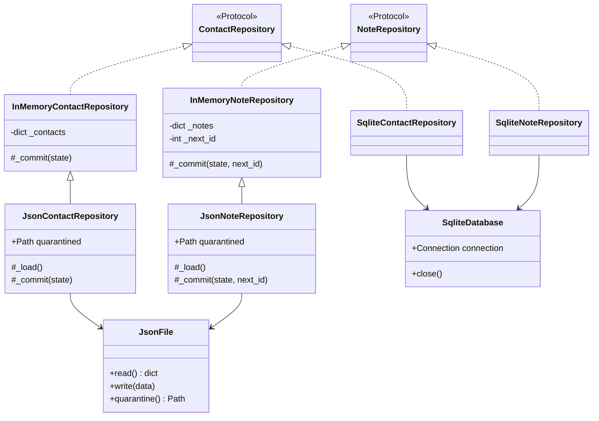

Три бекенди, і кожен реалізує обидва порти:

| Бекенд | Де лежать дані | Особливості |
|---|---|---|
| `json` (за замовчуванням) | `~/.personal_assistant/contacts.json`, `notes.json` | атомарний запис, карантин пошкоджених файлів |
| `sqlite` | `~/.personal_assistant/assistant.db` | `sqlite3` зі стандартної бібліотеки, без ORM; одне з'єднання на весь запуск |
| `memory` | лише в пам'яті | нічого не зберігає; використовується в тестах і як база для JSON |

Бекенд обирається змінною `PERSONAL_ASSISTANT_STORAGE`, каталог даних —
змінною `PERSONAL_ASSISTANT_HOME`.

**Як JSON спирається на in-memory.** In-memory репозиторій ніколи не змінює свій стан
напряму: він готує нову копію стану і передає її в `_commit(state)`. JSON-репозиторій
перевизначає `_commit`: спершу записує файл, і лише якщо запис вдався, викликає
`super()._commit(state)`. Тому, якщо диск видав помилку, дані в пам'яті не
розходяться з файлом.

### Завантаження й запис JSON

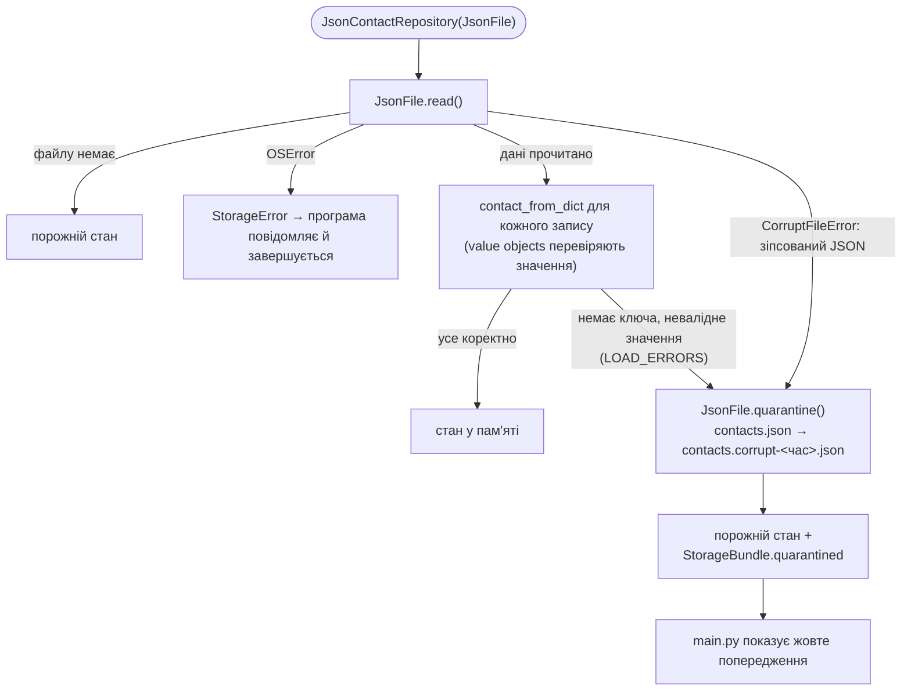

Запис атомарний: дані пишуться в тимчасовий файл у тому самому каталозі, далі
`fsync` і `os.replace`. Якщо програма впаде посеред запису, старий файл лишиться цілим.

Формат файлу:

```json
{
  "version": 1,
  "items": [
    {
      "id": "3f2a…",
      "name": "Олена",
      "phones": ["0501234567"],
      "email": "olena@example.com",
      "address": null,
      "birthday": "1990-11-20"
    }
  ]
}
```

### Схема SQLite

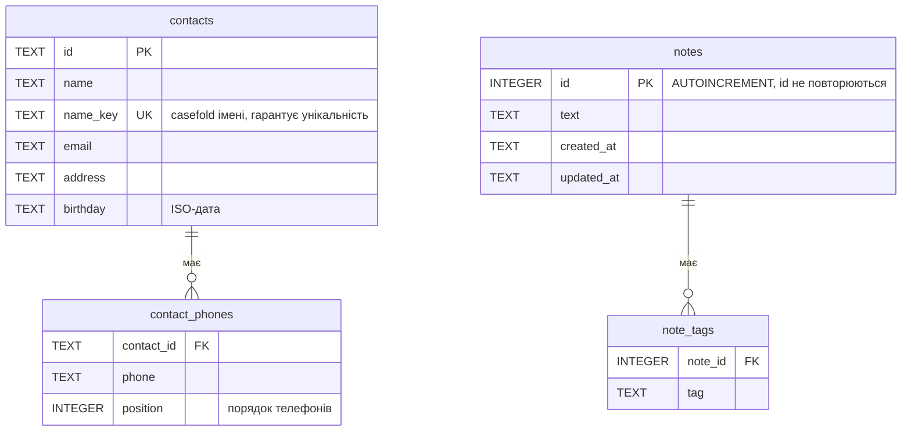

Зовнішні ключі мають `ON DELETE CASCADE`. Порушення `UNIQUE(name_key)`
перетворюється на `DuplicateContactError`, будь-яка інша помилка `sqlite3` — на
`StorageError` (через `storage_errors()`).

### Фабрика

`factory.py` зіставляє назву бекенду з функцією-будівником:

```python
STORAGE_BACKENDS = {"json": _json_storage, "sqlite": _sqlite_storage, "memory": _memory_storage}
```

Будівник повертає `StorageBundle`: обидва репозиторії, список файлів, відправлених у
карантин, і функцію `close`. Невідома назва бекенду дає `UnknownStorageBackendError`.

## 7. Презентація: CLI

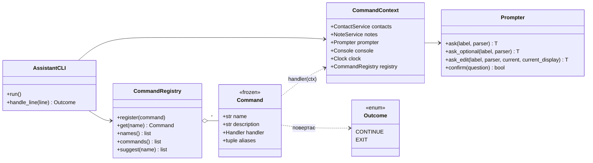

- **Команди без аргументів.** Користувач вводить лише назву, наприклад `add-contact`, а
  обробник питає поля по одному через `Prompter`. Якщо введене значення не проходить
  перевірку, `Prompter` показує помилку і питає знову.
- **Парсер — це будь-яка функція `str → T`.** Найчастіше це конструктор value object
  (`Name`, `Email`) або функція з `io/parsers.py` (`parse_phones`, `parse_tags`,
  `parse_days`).
- **Обробник команди** робить три кроки: питає дані, викликає сервіс, друкує результат
  через `views`. Бізнес-логіки в ньому немає.
- **`CommandRegistry`** зберігає команди та їхні псевдоніми (`exit` / `close`) і пропонує
  схожі назви через `difflib`, якщо команду введено з помилкою.
- **Тексти** зібрано в `messages.py`, а користувацькі дані виводяться лише через
  `rich.text.Text`, тобто буквально. Тому ім'я на кшталт `[red]Олег` не зламає
  розмітку Rich.

## 8. Як усе збирається: main.py

`main.py` — **composition root**: єдине місце, яке знає всі шари й створює конкретні
об'єкти.

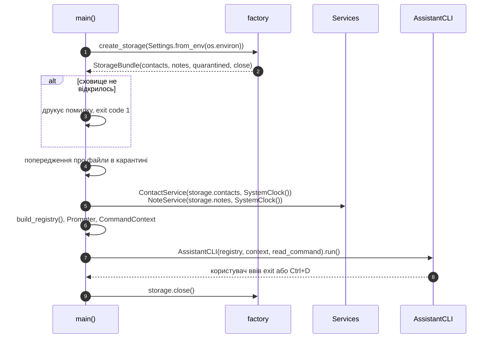

## 9. Шлях однієї команди

Як приклад візьмемо `add-contact` з JSON-сховищем:

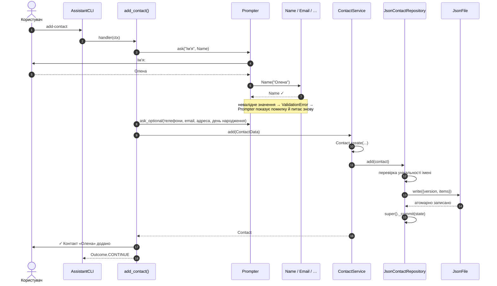

## 10. Обробка помилок

Помилки не перехоплюються там, де виникли: вони піднімаються до
**`AssistantCLI.handle_line`**, єдиного місця, де виняток стає повідомленням:

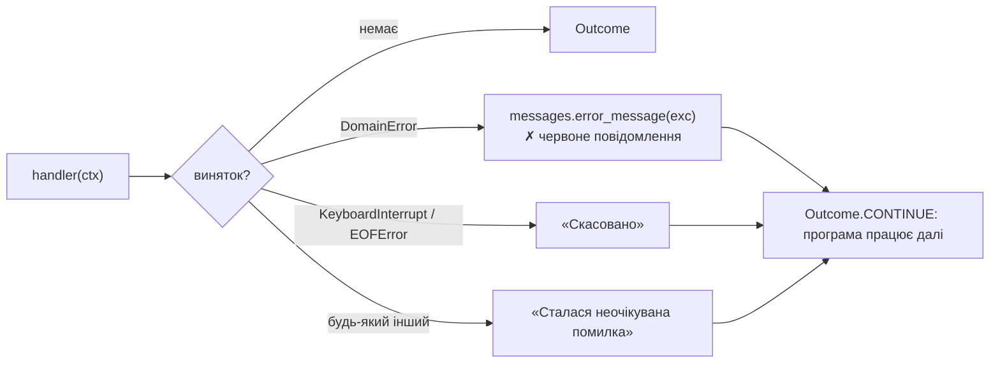

`ValidationError` під час введення ловить сам `Prompter` і питає знову. До
`handle_line` такі помилки доходять, лише коли їх кидає сервіс (наприклад,
`DuplicateContactError`).

## 11. Тести

```
tests/
├── conftest.py              FixedClock: «сьогодні» = 12.11.2026
├── domain/                  value objects, Contact, Note, сортування
├── application/             сервіси на in-memory репозиторіях
├── contract/                один набір тестів для всіх бекендів (json, sqlite, memory)
├── infrastructure/          особливості JSON (карантин, атомарність), SQLite, фабрика
└── presentation/            CLI зі сценарієм відповідей (фікстура harness), безпека розмітки
```

**Контрактні тести** (`tests/contract/`) доводять, що бекенди взаємозамінні: ті самі
тести проганяються для кожного з них. Фікстура повертає фабрику. Якщо викликати її
вдруге, сховище відкриється знову, і так перевіряється, що дані переживають
перезапуск.

## 12. Як розширювати

**Новий бекенд сховища** (наприклад, PostgreSQL):

1. Пакет `infrastructure/storage/postgres/` із класами, що реалізують
   `ContactRepository` і `NoteRepository` і кидають лише доменні помилки.
2. Функція-будівник і запис у `STORAGE_BACKENDS` у `infrastructure/factory.py`.
3. Бекенд у `BACKENDS` і обох фабриках у `tests/contract/conftest.py`.

Домен, сервіси й CLI не змінюються.

**Нова команда:**

1. Функція-обробник `def my_command(ctx: CommandContext) -> Outcome` у
   відповідному файлі `presentation/commands/`.
2. Запис `Command("my-command", messages.HELP_MY_COMMAND, my_command)` у кортежі
   `*_COMMANDS` цього файлу.
3. Тексти запитань і результатів у `messages.py`.

**Нова доменна помилка:** клас у `domain/errors.py` і запис у
`messages.ERROR_MESSAGES`.
